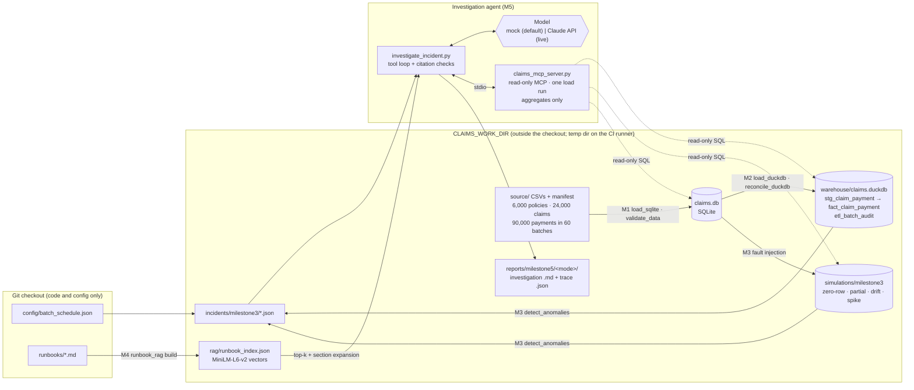
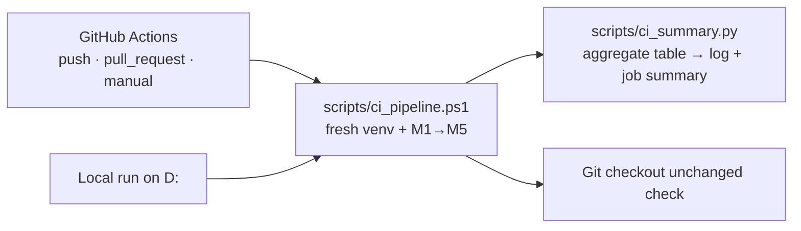

# claims-data-quality-copilot
An end-to-end insurance claims data pipeline designed to reconcile 90,000 synthetic payments, detect anomalies, and investigate failed loads with an AI agent using RAG and read-only MCP tools.

| Verification | Status |
|---|---|
| Full pipeline + **mock** agent verification | **PASSED** (local run on D:, see [Automation status](#automation-status)) |
| **Live Claude API** agent verification | **PENDING** (no `ANTHROPIC_API_KEY` has been used yet) |
| GitHub Actions run on a clean runner | **PENDING** (workflow added, not yet pushed) |

## Architecture





The workflow and a local run call the same `scripts/ci_pipeline.ps1`, so a passing local run
exercises the same steps, in the same order, as CI.

## Reproduce

Requirements: Windows, Python 3.15, Git. About 1.5 GB of disk for the virtual environment
(torch) and the generated data.

```powershell
git clone https://github.com/prajval151-cell/claims-data-quality-copilot.git
cd claims-data-quality-copilot

# Full pipeline in a NEW, empty directory outside the checkout (the script refuses a non-empty one)
powershell -NoProfile -ExecutionPolicy Bypass -File scripts\ci_pipeline.ps1 `
    -WorkDir D:\claims-demo\claims-copilot-work `
    -BasePython python
```

It creates `<WorkDir>\env\venv`, installs `requirements.txt` (wheels only), downloads the
embedding model on first use, then runs Milestones 1–5. It ends with an aggregate table
(also written to `<WorkDir>\ci_summary.md`) and a check that the checkout gained no files.
Add `-PipCacheDir <dir>` to reuse downloaded wheels. Use `-VenvPython <python.exe>` to
reuse an environment that already has `requirements.txt` installed; this skips the fresh
install, and the pins are still checked. Add `-RunLive` (with
`$env:ANTHROPIC_API_KEY` set) to also run the live Claude API verification, which is billed.
Without it the key is removed for the run and live verification reports PENDING.

To run single milestones by hand, use the per-milestone commands below with
`$env:CLAIMS_WORK_DIR` pointing at the same work directory.

## Demo walkthrough

1. **Generate and validate:** `generate_data.py` writes 90,000 payments (60 daily batches of
   1,500, 331,545,557,000 paise) from a fixed seed. Two runs give identical counts, totals
   and fingerprints.
2. **Load and reconcile:** `load_duckdb.py` moves each batch through staging into
   `fact_claim_payment` and records source / staging / target counts in `etl_batch_audit`.
   Reconciliation passes and a rerun is identical.
3. **Break it on purpose:** `verify_anomaly_scenarios.py` builds simulation warehouses.
   Each scenario's findings must match its expected set exactly:
   - zero-row: BATCH-20260115 dropped by a staging filter
   - partial load: 25 rows lost
   - amount drift: +100 paise
   - missing / stale batches
   - payment spike: BATCH-20260220 ×3, loaded cleanly
4. **Retrieve runbooks:** `runbook_rag.py` embeds the five runbooks. Each finding's top
   passage comes from the runbook for its finding type.
5. **Investigate:** `investigate_incident.py run --mode mock --incident <...>\zero_row_load.json`.
   The agent calls `get_run_summary` and `get_batch_audit` on the read-only MCP server. The
   report states *source 1,500 rows, staging 0, target 0* and the recorded staging filter
   `batch_id <> 'BATCH-20260115'`, then lists runbook causes and the next check. Each line
   cites `[E2: get_batch_audit(...)]` and `[P020: zero_row_load.md § Possible causes]`.
   - **Payment spike:** the report shows source = staging = target
     (21,337,838,955 paise), so the load reconciled. The total is about 3.5× the prior 7
     batches, which makes it a business anomaly rather than an ETL defect.
   - **Healthy run:** no retrieval, no MCP calls and no model calls.
6. **Live mode:** with `ANTHROPIC_API_KEY` set, `--mode live` sends the same loop to
   `claude-opus-5-5`. This is not verified yet (PENDING).

## Milestone 1: Synthetic source data

Generates deterministic synthetic insurance data with the Python standard library only
(fixed seed `20260101`), loads it into SQLite, and validates it.

| Dataset | Rows | Notes |
|---|---|---|
| `policies.csv` | 6,000 | HEALTH / MOTOR / HOME / TRAVEL, 1-year terms |
| `claims.csv` | 24,000 | APPROVED / REJECTED / PENDING; claim date within policy period |
| `payments/payments_YYYY-MM-DD.csv` | 60 files x 1,500 = 90,000 | Daily batches 2026-01-01 to 2026-03-01 |

All amounts are **integer paise** (`*_paise` columns; 1 rupee = 100 paise). For every paid
claim, the sum of its payments equals its approved amount exactly.

### Scripts

| Script | Purpose |
|---|---|
| `scripts/generate_data.py` | Writes CSVs and `manifest.json` (row counts + SHA-256 per file) to `$CLAIMS_WORK_DIR\source` |
| `scripts/load_sqlite.py` | Checks files against the manifest, rebuilds `$CLAIMS_WORK_DIR\claims.db` (STRICT tables, foreign keys) |
| `scripts/validate_data.py` | Runs the aggregate checks; `--compare` checks that two runs are identical |

### Work directory

`CLAIMS_WORK_DIR` is required and must point **outside** this Git repository. The scripts
exit with an error if it is unset or inside the repo. All CSVs, the database, and the
validation reports go there. `.gitignore` also ignores generated datasets and database
files as a backup.

### Commands (PowerShell)

Run from the repository root. Any directory outside the repo works; `D:\claims-copilot-work`
is used below.

```powershell
$env:CLAIMS_WORK_DIR = "D:\claims-copilot-work"

# Run 1
python scripts\generate_data.py
python scripts\load_sqlite.py
python scripts\validate_data.py --output "$env:CLAIMS_WORK_DIR\validation\run1.json"

# Run 2
python scripts\generate_data.py
python scripts\load_sqlite.py
python scripts\validate_data.py --output "$env:CLAIMS_WORK_DIR\validation\run2.json"

# Confirm both runs have identical row counts, payment totals and file fingerprints
python scripts\validate_data.py --compare "$env:CLAIMS_WORK_DIR\validation\run1.json" "$env:CLAIMS_WORK_DIR\validation\run2.json"

git status
```

Each command exits non-zero on failure. Validation checks: 60 batch files and 60 loaded
batches; 1,500 payments per batch; 90,000 total payments; unique payment IDs; CSV and DB row
counts and paise totals match; positive integer amounts; no orphan payments, claims, or
batches; a clean SQLite `foreign_key_check`; payments only on approved claims and dated on
or after the claim date; claim dates within the policy period; and paid total equal to the
approved amount for each paid claim.

## Milestone 2: SQLite to DuckDB with reconciliation

Loads the 60 payment batches from the Milestone 1 SQLite database (opened **read-only**)
into DuckDB `fact_claim_payment` via `stg_claim_payment`, then reconciles source to target.

| Script | Purpose |
|---|---|
| `scripts/load_duckdb.py` | Per batch, in one transaction: refill staging, replace that batch in `fact_claim_payment`, record source / staging / target rows and paise totals in `etl_batch_audit`. Rerunning never duplicates rows (batch replace + `payment_id` primary key). |
| `scripts/reconcile_duckdb.py` | Read-only. Compares full rows (all 8 columns) in both directions, IDs in both directions, per-column mismatches, duplicate IDs (separately, source and target), and per-batch and full-run row counts and exact integer-paise totals. `--compare` checks that two reports are identical. |

Everything stays on D: outside the repo: the virtual environment, pip cache, DuckDB
temp/extension dirs, Python bytecode cache, both DuckDB files (`warehouse\`) and reports
(`reports\milestone2\`).

### Setup (once)

DuckDB is the only dependency (`requirements.txt`, `duckdb==2.0.1`; abi3 wheel, works with
Python 3.15).

```powershell
$env:CLAIMS_WORK_DIR = "D:\claims-copilot-work"
$env:PIP_CACHE_DIR = "$env:CLAIMS_WORK_DIR\env\pip-cache"
$env:TMP = "$env:CLAIMS_WORK_DIR\env\tmp"; $env:TEMP = $env:TMP
New-Item -ItemType Directory -Force $env:TMP | Out-Null
python -m venv "$env:CLAIMS_WORK_DIR\env\venv"
& "$env:CLAIMS_WORK_DIR\env\venv\Scripts\python.exe" -m pip install -r requirements.txt
```

### Commands (PowerShell)

```powershell
$env:CLAIMS_WORK_DIR = "D:\claims-copilot-work"
$env:PYTHONPYCACHEPREFIX = "$env:CLAIMS_WORK_DIR\env\pycache"
$py = "$env:CLAIMS_WORK_DIR\env\venv\Scripts\python.exe"
$r = "$env:CLAIMS_WORK_DIR\reports\milestone2"

# Case 1: clean load
& $py scripts\load_duckdb.py
& $py scripts\reconcile_duckdb.py --output "$r\load1.json"

# Case 2: rerun the same batches and confirm identical results
& $py scripts\load_duckdb.py
& $py scripts\reconcile_duckdb.py --output "$r\load2.json"
& $py scripts\reconcile_duckdb.py --compare "$r\load1.json" "$r\load2.json"

# Case 3: zero-row simulation in a separate DuckDB file (staging filter drops one batch)
$sim = "$env:CLAIMS_WORK_DIR\warehouse\claims_zero_row_sim.duckdb"
& $py scripts\load_duckdb.py --db $sim --simulate-drop-batch BATCH-20260115
& $py scripts\reconcile_duckdb.py --db $sim --expect-dropped-batch BATCH-20260115 --output "$r\zero_row_sim.json"

git status
```

Each command exits non-zero on failure. `--simulate-*` options and `--source-db` are refused
for the main warehouse file. In case 3, reconciling the simulation file *without*
`--expect-dropped-batch` fails, as it should.

## Milestone 3: Anomaly detection and incident evidence

`scripts/detect_anomalies.py` reuses the Milestone 2 reconciliation (SQLite source read-only,
DuckDB `etl_batch_audit` for staging counts, `fact_claim_payment`). It writes a structured
incident JSON. Each finding has `check`, `category`, `batch_id`, `expected`, `observed`,
`unit`, `severity`, a message and evidence.

| Check | Category | Severity | Fires when |
|---|---|---|---|
| `zero_row_load` | ETL_INTEGRITY | CRITICAL | Source batch has rows, target has 0 (count/amount alerts for that batch are suppressed) |
| `row_count_mismatch` | ETL_INTEGRITY | HIGH | Source rows ≠ staging or target rows |
| `amount_mismatch` | ETL_INTEGRITY | HIGH | Source paise ≠ staging or target paise |
| `missing_expected_batch` | COMPLETENESS | HIGH | A batch due by the demo date (per schedule) is absent from the source, or was never loaded |
| `stale_data` | FRESHNESS | MEDIUM (1 day late), HIGH (2+) | Latest loaded batch is older than the latest batch due |
| `unusual_payment_total` | BUSINESS_ANOMALY | MEDIUM, HIGH at ≥ 2x or ≤ 0.5x median | Batch reconciles cleanly, but its total is far from the baseline |

**Freshness** uses `--demo-date` and the expected schedule in `config/batch_schedule.json`:
daily from 2026-01-01, `BATCH-%Y%m%d`, 1,500 rows, arrival lag 0 days, grace 0 days.

**Unusual payment totals:**
- Only batches whose source, staging and target agree are evaluated, so an ETL defect is
  never labelled a business anomaly.
- **Baseline:** the most recent 28 *prior* clean batches that were not themselves flagged.
- **Minimum history:** 14 batches. Batches with less history are listed as not evaluated.
- **Threshold:** flag when robust z = |total − median| / (1.4826 × MAD) ≥ 6.0 **and**
  |total / median − 1| ≥ 50%. On the healthy data, the worst values are z 4.48 and 35%.

`detect_anomalies.py` exits with 0 when there are no findings, 2 when there are findings,
and 1 on error. `verify_anomaly_scenarios.py` rebuilds simulation files under
`$CLAIMS_WORK_DIR\simulations\milestone3`. It requires each scenario's findings to equal its
expected set exactly, so a missed or extra alert fails the scenario.

| Scenario | Simulation | Expected findings |
|---|---|---|
| healthy | Main warehouse, demo date 2026-03-01 | None |
| zero_row_load | Staging drops all of BATCH-20260115 | `zero_row_load` |
| partial_load | Staging loses 25 rows of BATCH-20260210 | `row_count_mismatch`, `amount_mismatch` |
| amount_drift | Staging adds 100 paise to one BATCH-20260205 row | `amount_mismatch` |
| missing_batches | Main warehouse, demo date 2026-03-03 | `missing_expected_batch` x2, `stale_data` |
| payment_spike | SQLite *copy* with BATCH-20260220 amounts x3, loaded cleanly | `unusual_payment_total` only; reconciliation passes |

### Commands (PowerShell)

```powershell
$env:CLAIMS_WORK_DIR = "D:\claims-copilot-work"
$env:PYTHONPYCACHEPREFIX = "$env:CLAIMS_WORK_DIR\env\pycache"
$py = "$env:CLAIMS_WORK_DIR\env\venv\Scripts\python.exe"

# Healthy run against the main warehouse (expects exit code 0, no findings)
& $py scripts\detect_anomalies.py --demo-date 2026-03-01 --label healthy

# All scenarios: writes incidents\milestone3\<scenario>.json and validation_summary.json
& $py scripts\verify_anomaly_scenarios.py

git status
```

## Milestone 4: Runbook retrieval

`runbooks/` holds five short Markdown runbooks. Each has an overview naming its alert,
**Symptoms**, **Checks to run** and **Possible causes**, with generic examples only.

| Runbook | Finding types |
|---|---|
| `zero_row_load.md` | `zero_row_load` |
| `partial_load.md` | `row_count_mismatch` |
| `amount_mismatch.md` | `amount_mismatch` |
| `missing_or_stale_batches.md` | `missing_expected_batch`, `stale_data` |
| `unusual_payment_totals.md` | `unusual_payment_total` |

### RAG walkthrough (retrieval step)

1. **Split:** `runbook_rag.py build` splits each runbook into passages, one per section.
   The text before the first `##` heading becomes "Overview".
2. **Embed:** each passage is embedded locally on CPU with
   `sentence-transformers/all-MiniLM-L6-v2` (384 dimensions, normalized).
3. **Store:** vectors are saved with the source filename, runbook title, section title and
   passage text in `$CLAIMS_WORK_DIR\rag\runbook_index.json`. The index records a hash of the
   runbooks, and queries refuse to use a stale index.
4. **Query:** for each finding in an incident JSON from Milestone 3, the query text is built
   from the finding type, category, severity, message, expected and observed values, and
   every evidence field.
5. **Rank:** passages are ranked by cosine similarity and the top-k (default 3) are written
   to `$CLAIMS_WORK_DIR\reports\milestone4\<incident>_retrieval.json`.
6. **Skip healthy runs:** incidents with no findings skip retrieval (`"retrieval": "SKIPPED"`).

Generating an answer from the retrieved passages (Claude API) and MCP tools are covered in
Milestone 5 below.

The virtual environment, model download, Hugging Face/torch caches, temp files, vector index
and reports all live under `D:\claims-copilot-work`. fastembed is not used because
`onnxruntime` has no Python 3.15 wheel. There is no keyword fallback; retrieval always uses
embeddings.

### Setup (once)

```powershell
$env:CLAIMS_WORK_DIR = "D:\claims-copilot-work"
$env:PIP_CACHE_DIR = "$env:CLAIMS_WORK_DIR\env\pip-cache"
$env:TMP = "$env:CLAIMS_WORK_DIR\env\tmp"; $env:TEMP = $env:TMP
& "$env:CLAIMS_WORK_DIR\env\venv\Scripts\python.exe" -m pip install --only-binary=:all: -r requirements.txt
```

### Commands (PowerShell)

```powershell
$env:CLAIMS_WORK_DIR = "D:\claims-copilot-work"
$env:PYTHONPYCACHEPREFIX = "$env:CLAIMS_WORK_DIR\env\pycache"
$env:TMP = "$env:CLAIMS_WORK_DIR\env\tmp"; $env:TEMP = $env:TMP
$py = "$env:CLAIMS_WORK_DIR\env\venv\Scripts\python.exe"

# Build the vector index from runbooks\*.md
& $py scripts\runbook_rag.py build

# Retrieve runbook passages for one incident
& $py scripts\runbook_rag.py query --incident "$env:CLAIMS_WORK_DIR\incidents\milestone3\zero_row_load.json"

# Verify against all Milestone 3 incidents (healthy must skip; each finding must hit its runbook)
& $py scripts\runbook_rag.py verify

git status
```

## Milestone 5: Investigation agent with read-only MCP tools

`scripts/investigate_incident.py` takes a Milestone 3 incident JSON and writes a Markdown
investigation report. For each conclusion the report cites the runbook section and the MCP
evidence it relies on.

| Script | Purpose |
|---|---|
| `scripts/claims_mcp_server.py` | Read-only MCP server (stdio) with aggregate evidence tools for **one** load run |
| `scripts/investigate_incident.py` | Agent: retrieval, model ↔ MCP tool loop, citation checks, Markdown report, `verify` |
| `scripts/agent_models.py` | Model backends: deterministic `MockModel` and live `ClaudeModel` |

### Workflow

1. **Healthy runs:** an incident with no findings gets a short report. Runbook retrieval,
   MCP calls and model calls are all skipped (0 / 0 / 0).
2. **Retrieval:** each finding is embedded with the Milestone 4 index (top-k by cosine).
   The remaining sections of the top-ranked runbook are then added (*section expansion*).
   Top-k alone usually returns only Overview/Symptoms, and the report needs
   **Possible causes** and **Checks to run** to cite. The report lists each section with
   how it was retrieved (`similarity` or `section_expansion`) and its cosine score.
3. **Evidence:** the agent starts `claims_mcp_server.py --incident <file>` over stdio.
   The model chooses which tools to call, and each result gets an evidence ID (`E1`, `E2`, …).
4. **Report:** the model calls `submit_report`. Each observed fact must cite MCP evidence.
   Each possible cause and the next verification step must cite a runbook passage retrieved
   for that finding, plus MCP evidence. If a citation is invalid, the report goes back to
   the model as a tool error, with at most 2 resubmissions.
5. **Fallback:** if a model call fails (API error, refusal, truncation, no valid report),
   the report keeps the original SQL findings, the retrieved runbook sections and any
   evidence already gathered. Its status is `FALLBACK_SQL_FINDINGS` and `run` exits with 2.

### MCP server: scope and safety

| Tool | Returns (aggregates only) |
|---|---|
| `get_run_summary()` | Load-run record (status, times, staging filter), run-level source/staging/target rows and paise, batches that do not reconcile |
| `get_batch_audit(batch_id)` | One batch's source/staging/target rows and paise from `etl_batch_audit`, the stage where they first diverge, and whether `fact_claim_payment` still matches |
| `get_batch_profile(batch_id, layer)` | `source` or `target`: rows, paise, distinct claims, amount percentiles, top-1% share, totals by payment method and payee type |
| `get_batch_history(batch_id, window)` | Up to 28 prior batches in the run, the median of the prior reconciled batches, and this batch's ratio to it |

- **Fixed scope:** the server reads the DuckDB file, SQLite source and `run_id` from the
  incident at startup. For simulated incidents that is the simulation warehouse (for example
  `simulations\milestone3\zero_row_load.duckdb`, or the payment-spike SQLite copy), so the
  agent sees the same stage counts that triggered the anomaly. Tools take no paths or run
  IDs, and every query is filtered to that run.
- **Read-only:** DuckDB is opened with `read_only=True` and SQLite with `mode=ro` on every
  call. All tools carry `readOnlyHint`. Both files must be under `CLAIMS_WORK_DIR` and
  outside the repo.
- **Parameterized:** all values are bound with `?`; table and column names are constants.
  `batch_id` must match `BATCH-YYYYMMDD` and exist in the selected run, `layer` is an
  enum, and `window` is 1–28. Rejected input returns a tool error.
- **Aggregate only:** no payment, claim or transaction identifiers are returned.
- **No credentials:** the server process is started without `ANTHROPIC_API_KEY`.

### Model modes

| Mode | What runs | Credentials |
|---|---|---|
| `mock` | `MockModel`, a deterministic test double in the same tool loop. Turn 1 requests evidence; turn 2 submits facts read from the MCP results, with causes and next steps taken from the retrieved runbook sections. It tests the workflow, not reasoning. | None, no network |
| `live` | Claude API, `claude-opus-5-5`, adaptive thinking, effort `high`, server-side refusal fallback (`fallbacks: "default"`) | `ANTHROPIC_API_KEY` from the environment |

Every report states its mode at the top. Live reports also list the API request IDs and the
model that served each turn. The API key is only read from the environment; it is never
written to reports, traces or the repo. With no key, live mode reports **PENDING** (exit 3)
and makes no API call.

### Setup (once)

```powershell
$env:CLAIMS_WORK_DIR = "D:\claims-copilot-work"
$env:PIP_CACHE_DIR = "$env:CLAIMS_WORK_DIR\env\pip-cache"
$env:TMP = "$env:CLAIMS_WORK_DIR\env\tmp"; $env:TEMP = $env:TMP
& "$env:CLAIMS_WORK_DIR\env\venv\Scripts\python.exe" -m pip install --only-binary=:all: -r requirements.txt
```

### Commands (PowerShell)

```powershell
$env:CLAIMS_WORK_DIR = "D:\claims-copilot-work"
$env:PYTHONPYCACHEPREFIX = "$env:CLAIMS_WORK_DIR\env\pycache"
$env:TMP = "$env:CLAIMS_WORK_DIR\env\tmp"; $env:TEMP = $env:TMP
$env:HF_HUB_OFFLINE = "1"          # use the cached embedding model
$env:PYTHONIOENCODING = "utf-8"
$py = "$env:CLAIMS_WORK_DIR\env\venv\Scripts\python.exe"
$inc = "$env:CLAIMS_WORK_DIR\incidents\milestone3"

# Prerequisites: Milestone 3 incidents and the Milestone 4 index
& $py scripts\verify_anomaly_scenarios.py
& $py scripts\runbook_rag.py build

# Mock mode: investigate single incidents (no credentials needed)
& $py scripts\investigate_incident.py run --mode mock --incident "$inc\zero_row_load.json"
& $py scripts\investigate_incident.py run --mode mock --incident "$inc\payment_spike.json"
& $py scripts\investigate_incident.py run --mode mock --incident "$inc\healthy.json"

# Mock mode: exercise the fallback (the model call fails; SQL findings are kept, exit 2)
& $py scripts\investigate_incident.py run --mode mock --incident "$inc\zero_row_load.json" --simulate-model-failure

# Mock verification: zero-row, payment-spike, healthy skip, model-failure fallback,
# database integrity and MCP input rejection
& $py scripts\investigate_incident.py verify --mode mock

# Live verification (Claude API). Set the key for this session only; never commit it.
$env:ANTHROPIC_API_KEY = "<your key>"
& $py scripts\investigate_incident.py verify --mode live
Remove-Item Env:\ANTHROPIC_API_KEY

# Inspect the MCP server's fixed scope for an incident
& $py scripts\claims_mcp_server.py --incident "$inc\payment_spike.json" --describe

git status
```

Reports, traces and verification summaries are written to
`$CLAIMS_WORK_DIR\reports\milestone5\mock\` and `...\live\`:
`<incident>_investigation.md`, `<incident>_trace.json` (MCP calls with their arguments and
results, model turns, validation attempts) and `verification_<mode>.json`.

Exit codes: `run` returns 0 (analysed or skipped), 2 (fell back to SQL findings) or 3 (live,
key not set). `verify` returns 0 (passed), 1 (failed) or 3 (live, pending).

`verify` checks:
- **Zero-row:** `get_batch_audit` returns 1,500 source / 0 staging / 0 target rows. These
  match the incident evidence, and a report statement citing that evidence states them.
- **Payment spike:** the audit shows source = staging = target rows and paise, and a report
  statement citing the audit or run summary explains that source and target reconciled.
- **Healthy:** 0 retrieval, 0 MCP and 0 model calls.
- **Mock only:** a simulated model failure still produces a report with the SQL findings.
- **Always:** SHA-256 of the databases is unchanged, and the MCP server rejects an
  injection-style `batch_id`, a batch outside the run, an unknown layer and an
  out-of-range window.

## Milestone 6: GitHub Actions automation

`.github/workflows/demo-pipeline.yml` runs the whole pipeline on `windows-latest` (Windows
PowerShell 5.1, Python 3.15). Triggers: every push, every pull request, and manual dispatch.

| Step | What it does |
|---|---|
| Checkout / setup-python | Actions pinned to commit SHAs (checkout v7.0.1, setup-python v7.1.0, cache v6.1.0); `contents: read` only; no persisted credentials |
| Work directory | `$RUNNER_TEMP\claims-copilot-work`, outside `$GITHUB_WORKSPACE` |
| Cache | pip wheel downloads only (`$RUNNER_TEMP\pip-cache`, keyed on `requirements.txt`); no generated data is cached |
| Run pipeline | `scripts\ci_pipeline.ps1`: fresh venv, all 90,000 payments through M1–M5, mock agent verification, live verification (PENDING unless enabled), checkout-unchanged check, aggregate job summary |
| Cleanup | Deletes the work directory (`if: always()`). No `upload-artifact` step: generated files never leave the runner |

**Output policy:** every script prints only counts, paise totals, batch-level check results
and statuses. No payment, claim or policy records are printed. `ci_summary.py` writes one
aggregate table to the log and to the GitHub job summary.

**Live Claude API:** pushes and pull requests never receive the key. A manual run with
`run_live: true` passes the `ANTHROPIC_API_KEY` repository secret to the live verification,
which is billed. Without it the live step reports PENDING and the run still passes.

**Scheduled run:** not enabled yet. The workflow has a commented-out weekly `schedule:`
block. Uncomment it once a push or manual run has finished green on a clean runner.

### Automation status

| Check | Verified locally on D: | Needs a GitHub Actions run |
|---|---|---|
| Workflow YAML parses; triggers push / pull_request / workflow_dispatch; schedule inactive; actions SHA-pinned; no artifact upload | Yes (static check) | Run to confirm GitHub accepts it |
| `ci_pipeline.ps1` M1–M5 end to end in a new, empty work directory, all 90,000 payments | **Yes**: all steps passed in 5.2 min (existing D: venv via `-VenvPython`) | Yes: clean `windows-latest` image |
| Fresh venv + `pip install -r requirements.txt` inside the pipeline | **No**: the local attempt failed with `MemoryError` in pip because C: (pagefile drive) had 0 MB free. All 5 pins are confirmed installed in the reused venv | **Yes** |
| Embedding model downloaded on a cold cache | Yes (87.4 MB fetched into the new work dir) | Yes |
| Mock agent verification | **PASSED** (28/28 checks, 4 cases) | Yes |
| Live Claude API verification | **PENDING** (no key) | PENDING until a manual run with `run_live: true` and the secret |
| Git checkout gains no files during the run | Yes | Yes |
| Log contains no record-level IDs (no `POL-`, `CLM-`, `PAY-` values) | Yes (log scanned) | Yes |
| `actions/setup-python` provides Python 3.15 on `windows-latest` | No (local interpreter used) | **Yes** |
| Cold pip cache: all wheels download from PyPI | No | **Yes** |
| `$GITHUB_ENV` / `$GITHUB_STEP_SUMMARY` writes, `::group::` log folding, cache restore/save | No | **Yes** |
| `run_live` input gating of the secret | No | **Yes** |
| Work directory removed at the end | No (local run kept for inspection) | **Yes** |
| Weekly scheduled run | Not enabled | After the first green run |

### Commands (PowerShell)

```powershell
# Local run, exactly as in CI (fresh venv + install), in a NEW empty directory on D:
powershell -NoProfile -ExecutionPolicy Bypass -File scripts\ci_pipeline.ps1 `
    -WorkDir D:\claims-ci-local\run1\claims-copilot-work `
    -BasePython python `
    -PipCacheDir D:\claims-copilot-work\env\pip-cache

# Local run reusing an existing environment (skips the fresh install; used for the verified run)
powershell -NoProfile -ExecutionPolicy Bypass -File scripts\ci_pipeline.ps1 `
    -WorkDir D:\claims-ci-local\run2\claims-copilot-work `
    -VenvPython D:\claims-copilot-work\env\venv\Scripts\python.exe

# The aggregate summary of that run
Get-Content D:\claims-ci-local\run2\claims-copilot-work\ci_summary.md

git status
```
